# OpsRemote

A portable terminal and remote-access workspace for Linux and Windows. Local terminals, SSH with file transfer, remote desktop (RDP), VNC, tunnels and network tools in one program, run straight from a folder or a USB stick. There is nothing to install and no administrator rights are needed.

Created by **Thanos Athanasopoulos** ([@sektorhybrid](https://github.com/sektorhybrid)). Free software under the [GNU GPL, version 3 or later](LICENSE). 

I started OpsRemote nearly eight years ago to put my own ideas for remote-access tools into practice and bring together features I needed in my daily work as an engineer. Its design reflects that experience, with room to rethink familiar workflows and explore less conventional approaches where they make everyday tasks easier. Development progressed around limited spare time and the challenges of building a secure and portable application with a flexible interface, custom remote sessions and integrated file transfer. More recently, substantial development and refactoring have been carried out with assistance from Claude and Codex, guided by that original vision.

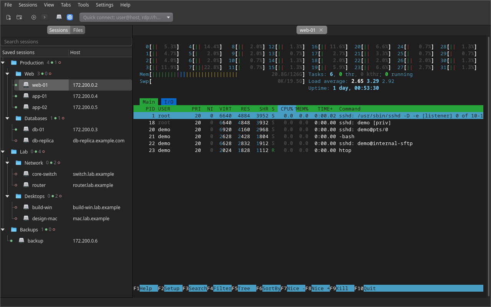

## Features

- **One window for every connection:** SSH (with certificates, security keys and Kerberos), SFTP/SCP, FTP/FTPS, RDP, VNC, Telnet, serial, Mosh, Rlogin/RSH and XDMCP. All open in tabs, which can be split into panes.
- **Sessions in folders:** each host has a live status dot, plus search, Pinned and Recent. Import from `~/.ssh/config`, PuTTY, MobaXterm, mRemoteNG and Remmina.
- **Files pane:** browse the active SSH tab's server, drag and drop, sync folders, edit remote files, and use safe uploads.
- **SSH tunnels:** Local, Remote, SOCKS, Reverse SOCKS, Socket and HTTP proxy forwards. Each tunnel is shown as a diagram with live state, traffic and checks. Jump hosts can be chained.
- **Remote desktop:** dynamic resolution, high-DPI, clipboard and files, drives, sound, printers, RD Gateway and full screen.
- **Automation:** login scripts and triggers, saved scripts run in a tab or on many hosts, and Commands and Scripts tabs next to Sessions and Files.
- **Local and containers:** local shells, WSL, Docker and Kubernetes shells as saved sessions, here or on an SSH server.
- **Tools:** run a command or a saved script on many hosts, multi-exec and broadcast, recordings, SSH key and Kubernetes credential managers, local TFTP and HTTP servers. The network tools cover ping, traceroute, port scan, iperf3 bandwidth, downloads and HTTP requests.
- **Secure passwords:** an encrypted, portable vault (Argon2id + XChaCha20-Poly1305) or the system credential store.
- **Looks:** ready-made themes (light, dark, macOS-like WhiteSur and Mojave, Nord, Dracula and more), 89 terminal colour schemes and 15 icon themes. You can save looks of your own.
- **Portable:** Linux and Windows in one folder, sharing the same `settings/`.

The full list is in **[docs/features.md](docs/features.md)**.

## Screenshots

| | |
|---|---|
| 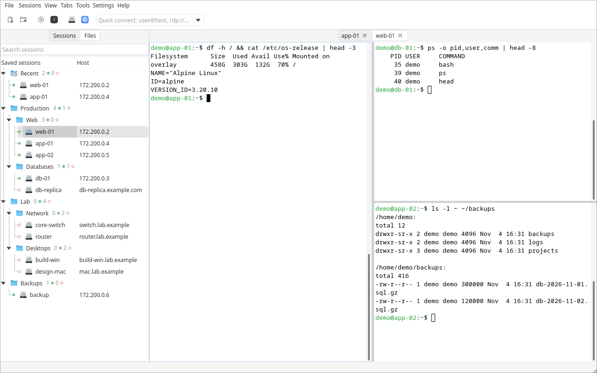 Split panes on several servers | 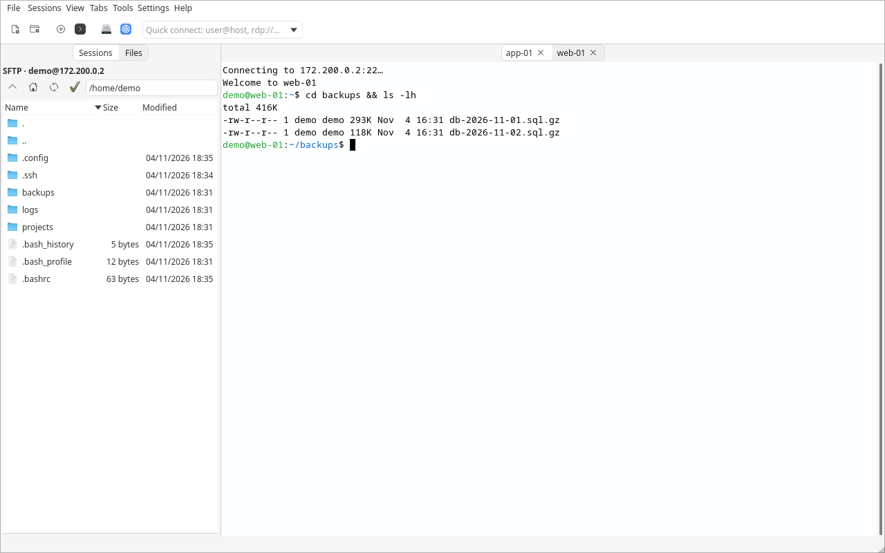 Files pane next to the terminal |
| 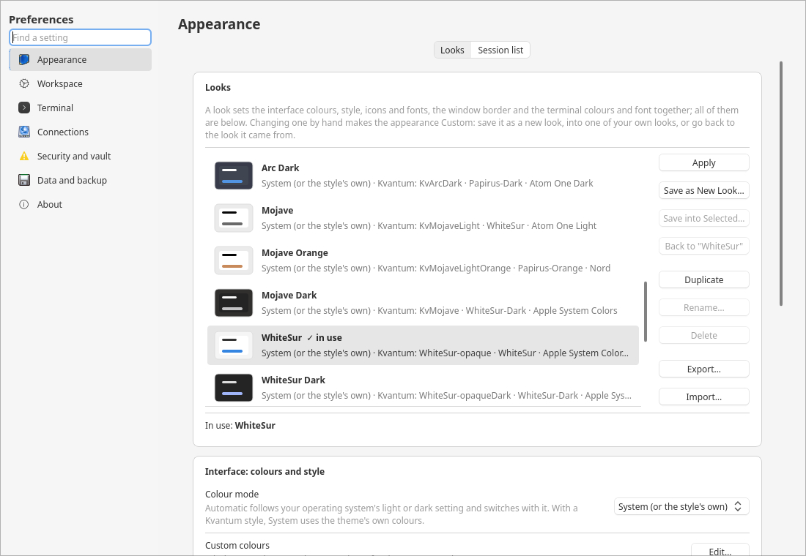 Preferences → Appearance → Looks | 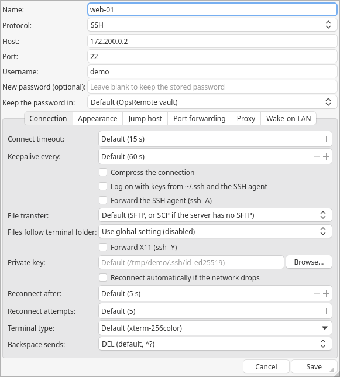 Session editor |
| 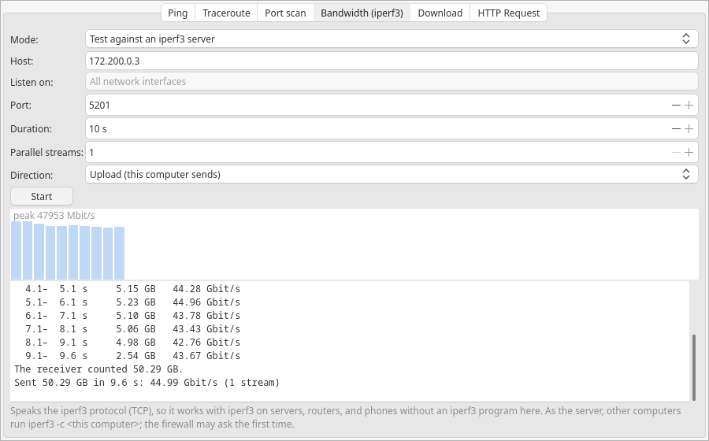 Network tools: iperf3 bandwidth test | 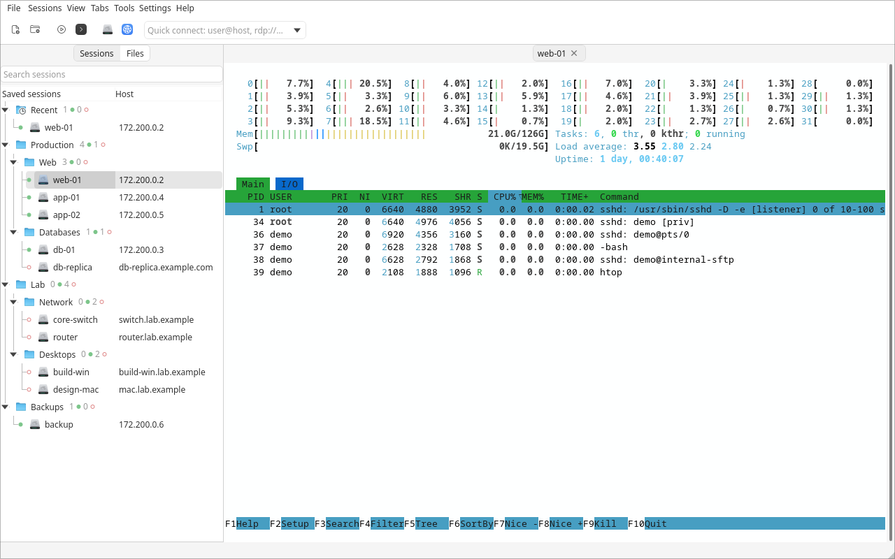 WhiteSur: session tree with status dots and htop |
| 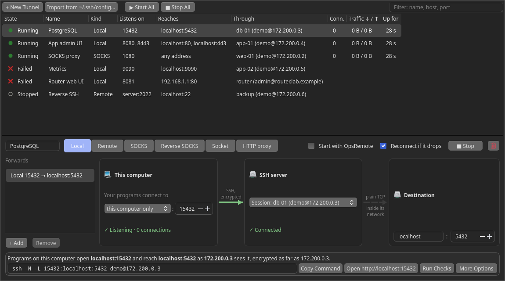 SSH tunnels | 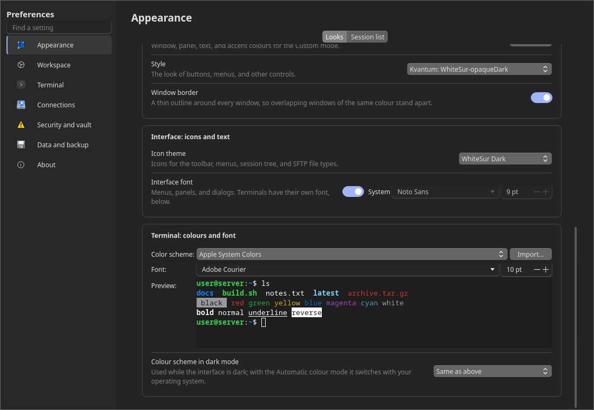 Terminal colours and font |
| 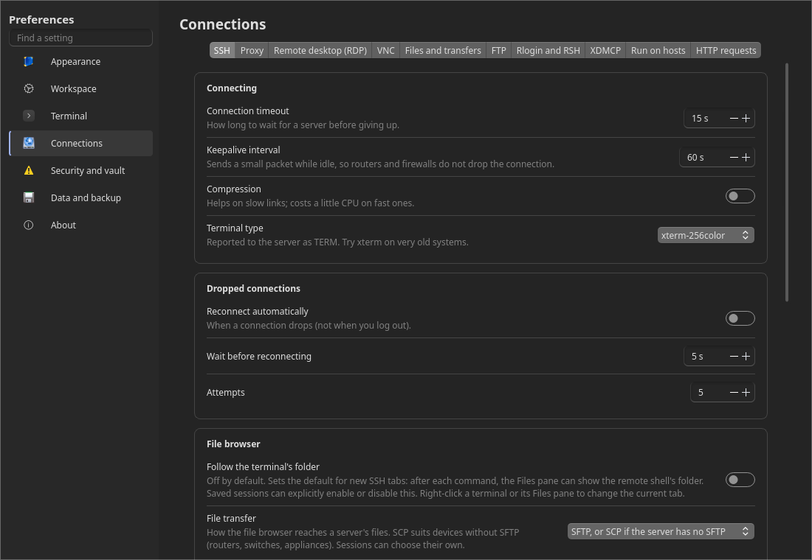 Preferences → Connections | 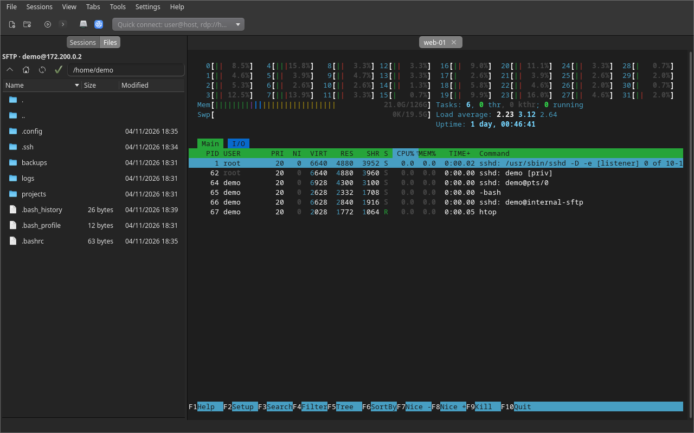 WhiteSur Dark: Files pane and htop |

## Getting started

Download the package from the [releases](https://github.com/sektorhybrid/OpsRemote/releases), extract it anywhere, and start:

- **Linux:** `OpsRemote`. Needs glibc 2.34 or newer (RHEL/Alma/Rocky 9, Ubuntu 22.04+, Debian 12+, current Fedora and Arch) and an X11 or Wayland desktop.
- **Windows:** `OpsRemote.exe`. Needs 64-bit Windows 10 (1809) or 11.

The first start of each version unpacks the program, which takes a few seconds. Your sessions, preferences and vault stay in the package's `settings/` folder.

## Documentation

| Page | What's in it |
|---|---|
| [What's new](docs/changes.md) | The changes of each version |
| [Features](docs/features.md) | Every feature in detail |
| [Portable data](docs/portable-data.md) | Where sessions, preferences, the vault and host keys are kept |
| [Building](docs/building.md) | Building from source, the package scripts, the project layout |
| [Publishing a release](docs/releasing.md) | Steps for a release and its source archive |
| [Third-party components](THIRD_PARTY.md) | Bundled components and their licences |

## Licence

OpsRemote is © 2026 Thanos Athanasopoulos and is free software: you can redistribute it and/or modify it under the terms of the GNU General Public License as published by the Free Software Foundation, either version 3 of the License or (at your option) any later version. It comes with ABSOLUTELY NO WARRANTY, to the extent permitted by law. See [LICENSE](LICENSE).

It includes and bundles third-party components under their own compatible licences, including modified copies of QTermWidget and Kvantum. See [THIRD_PARTY.md](THIRD_PARTY.md). Release packages carry every component's licence text in `licenses/`, and `SOURCES.txt` says where the source of everything in them is.
